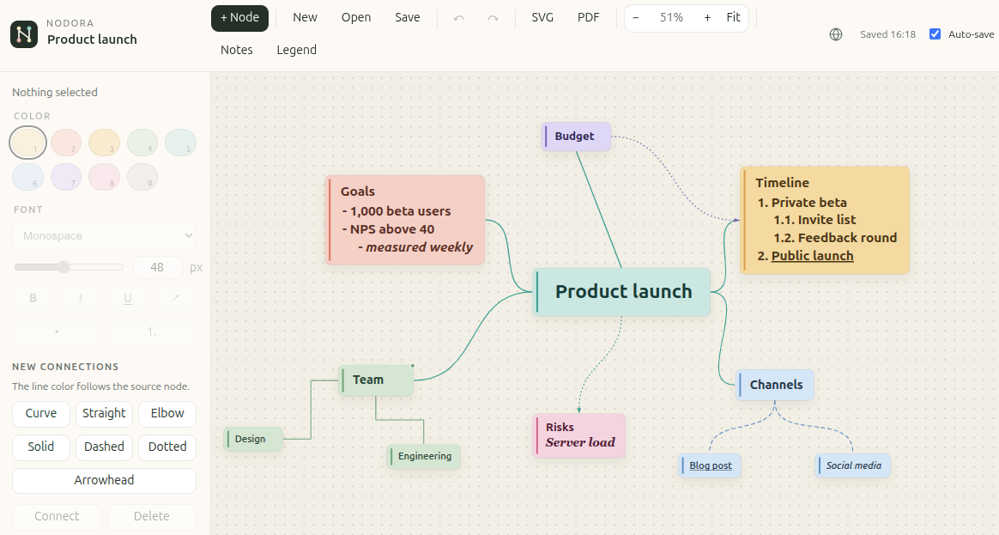

<p align="center">
  
</p>

# Nodora

Nodora is a local, browser-based application for creating brainstorming maps. It runs entirely on your computer: a small Python server delivers the page, and the editor itself is a single-page application with no build step and no external services.

A map can contain colored nodes, styled text, lists, notes, and several kinds of connections. Work is restored automatically, and a map can be saved as JSON or exported as SVG or PDF.



## Documentation

| Guide | Contents |
| --- | --- |
| [User guide](docs/user-guide.md) | Creating and editing maps, selection, notes, languages, shortcuts, saving, and export |
| [Installation](docs/installation.md) | Ubuntu, macOS, and Windows installers, hostname, autostart, CLI, and reconfiguration |
| [Technical reference](docs/reference.md) | Project layout, data format, storage, server, and implementation limits |

## Quick start

Python 3.10 or newer is required for the installer.

```bash
# Ubuntu / Linux
chmod +x install-linux.sh
./install-linux.sh
```

```bash
# macOS
chmod +x install-macos.command
./install-macos.command
```

```powershell
# Windows
powershell -ExecutionPolicy Bypass -File .\install-windows.ps1
```

The installer asks for an installation folder, a free port, and a local hostname. The suggested hostname is `<user>.nodora.local`, using the account name on this computer. After a successful installation or reconfiguration, the application opens in the default browser, for example:

```text
http://cy-rae.nodora.local:8765
```

The server also starts automatically the next time you sign in. These commands are then available:

| Command | Purpose |
| --- | --- |
| `nodora-start` | Start the server |
| `nodora-stop` | Stop the server |
| `nodora-status` | Show whether it is running and print its URL |
| `nodora-open` | Start the server and open the browser |
| `nodora-manager` | Reconfigure, reinstall, or remove the application |

On Linux and macOS, open a new terminal if a command is not found immediately after installation.

## Run the source directory directly

The page can also be opened from the project directory without installing it:

```bash
python3 server.py --port 8765
```

Then open `http://127.0.0.1:8765`. This development server does not configure a hostname, command-line shortcuts, or sign-in autostart. Browser storage is separate for every origin, so a map saved at `127.0.0.1` does not automatically appear at `<user>.nodora.local`.

## License

Nodora is released under the [MIT License](LICENSE). Commercial use, modification, and distribution are allowed. Copies must keep the copyright and license notice.
